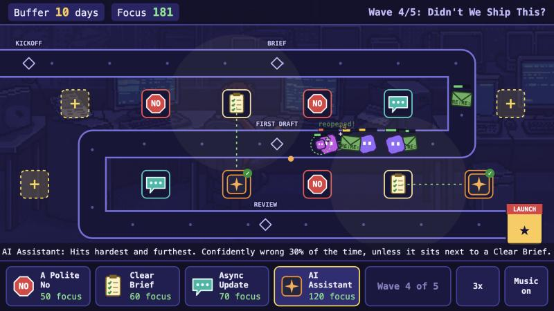

# Career Quest: Defend the Deadline

A small browser tower-defense game about shipping a project on time. Work walks a project
timeline toward launch day; you place towers to deal with it before it eats your buffer.
A full run takes about four minutes.



Vanilla JavaScript on an HTML canvas. No dependencies and no build step. Built with AI assistance.

## How to play

- Pick a tower from the bar below the map, then click or tap a **+** spot to place it.
- Click or tap a placed tower to sell it for 60% of its cost.
- Press **Start wave** when you are ready. There are five waves; the last one is the boss.
- Each thing that reaches launch day costs buffer days. At zero, the launch slips.
- The speed button cycles 1x, 2x, 3x. The music button mutes the soundtrack.

Works with mouse and touch, on a laptop or a phone held sideways.

### Towers

| Tower | Cost | What it does |
| --- | --- | --- |
| A Polite No | 50 | Steady single-target damage. |
| Clear Brief | 60 | Slows everything nearby, stops scope creep growing, and keeps a neighbouring AI Assistant on target. |
| Async Update | 70 | Pulses that hit everything in range. Dissolves quick syncs. Cannot be frozen. |
| AI Assistant | 120 | Highest damage and longest range. Misfires at one of your own towers 30% of the time, or 3% when placed next to a Clear Brief. |

### What you are up against

| Enemy | Behaviour |
| --- | --- |
| Scope Creep | Grows the longer it lives, unless it is inside a Clear Brief's range. |
| Quick Sync | Periodically freezes towers near it. |
| Ticket | Splits into two sub-tasks when closed. |
| Zombie Thread | Reopens things you already shipped. |
| One More Round of Feedback | The boss. It comes back twice. |

## Run it locally

Either open the file directly:

```
open index.html
```

or serve the folder (this is what a host like Vercel does):

```
python3 -m http.server 8000
```

then visit http://localhost:8000.

## Project layout

```
index.html            Page, HUD and screens
css/game.css          Layout and styling (the stage is a fixed 960x540 box scaled to fit)
js/config.js          All tunable data: towers, enemies, waves, layout, end-screen links
js/sim.js             Game rules. No DOM, so it also runs under node
js/render.js          Canvas drawing
js/main.js            Input, HUD, screens, music
assets/, audio/       Backgrounds, the ticket sprite and the soundtrack
classic/              The original 2025 side-scrolling shooter, still playable at /classic/
documents/            Notes for the original shooter concept
```

To rebalance the game, edit the numbers in `js/config.js`. The end-screen portfolio links
are in `CQ.LINKS` at the bottom of that file.

## Credits

- Game: Dave Graham, built with AI assistance.
- Music: made with Suno.
- Background art and the office scene: AI-generated images from the original shooter.
- Everything else is drawn in code.

MIT licensed. See `LICENSE`.
